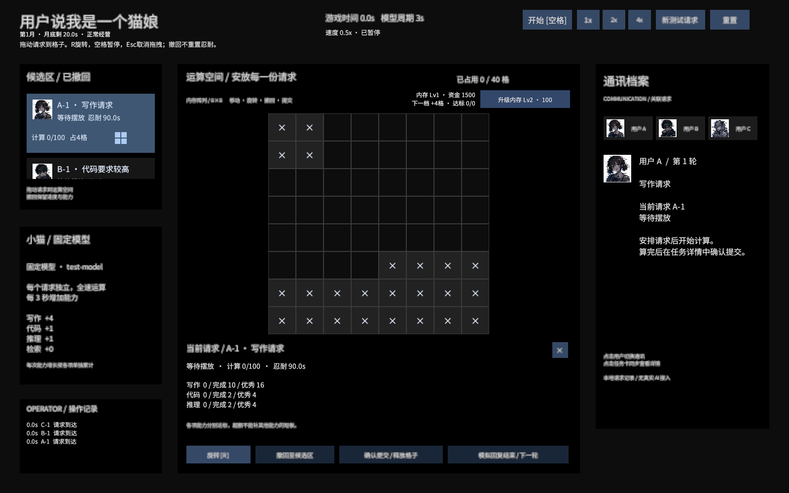
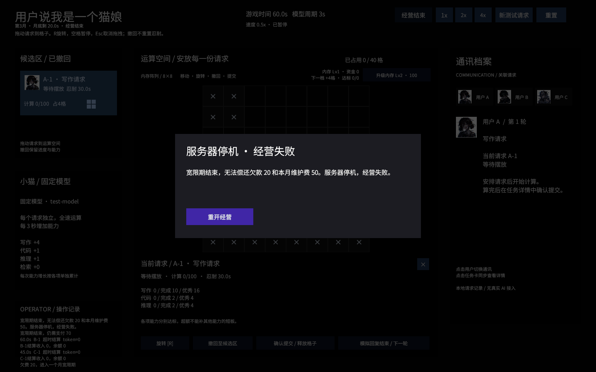

# h 与 sdfsdhg-patch-1 合并评审

评审分支：`review/merge-economy`。基础为 h 的 `058487f`，合入 `sdfsdhg-patch-1` 的 `63b74ab`。主工作区和远端 h 保持不变。

## 请先判断的新增规则

| 新增内容 | 当前评审实现 | 需要判断 |
|---|---|---|
| 达标提交收入 | 完成/优秀提交后，Token × 单价入账；重复事件不重复入账 | 是否认可按Token计价？优秀是否应有加成？ |
| 未达标提交 | 不增加完成计数，不给收入 | 是否要给部分收入或扣声望？当前仅保留无收入规则 |
| 超时结算 | 已计算比例对应Token仍产生收入 | 失败订单是否应该有收入？这是新分支的原规则 |
| 每月维护费 | 每20游戏秒扣50；倍率加速，暂停冻结 | 周期和金额是否合适？ |
| 欠费宽限 | 用剩余资金支付部分费用，欠款保留；下个月须付欠款+当月维护费 | 是否保留一个月宽限？是否允许部分偿还？当前需一次付清 |
| 停机失败 | 宽限期结束仍不足，停止时间和任务操作，显示失败面板，可重开 | 是否保留硬失败？ |
| 初始资金 | GameplayConfiguration.InitialFunds，当前默认1500；新开局或重开时读取 | 已确定通过配置调整，后续可直接设置 |

主配置中调整：`InitialFunds`、`TokenPrice`、`MonthlyMaintenanceFee`、`SecondsPerGameMonth`。内存升级继续使用可视化内存配置中的各级价格。

## 可直接观察的例子

- 达标提交100 Token，单价1：资金增加100。
- 未达标提交：收入0。
- 超时完成50%，总Token100：收入50。
- 测试资金80，维护费50，期间无收入：第20游戏秒余额30；第40秒欠20并进入宽限；第60秒需支付70，否则停机。
- 宽限期内获得70：下个月支付70后欠款清零，恢复正常经营。

## 合并时修正的接入问题

- 上传代码接入 `Assets/_Game`，使用已有场景、Prefab和头像。
- `EconomyManager` 成为唯一钱包，任务收入、扩容支出、维护费使用同一份余额；移除不起作用的固定升级价格，保留各级价格。
- 提交立即结算；月底先处理当时可入账的任务事件，再扣费。
- 一次推进跨多个月时逐月结算；失败时停止剩余时间推进。
- 失败后关闭任务操作和升级，提供可见失败原因与重开按钮。
- 收入统一按乘积四舍六入五成双到整数，兼容新分支控制器的 RoundToInt；不混用经济类的先截断Token规则。

## 验证

自动化覆盖原有任务/格子/能力/暂停/头像/内存升级，以及成功收入、未达标收入、超时部分收入、重复结算、维护费、宽限、还款、月底边界收入、跨多月、失败冻结与重开。

Unity 6000.5.2f1 自动化检查：45/45通过。Windows开发版本打包成功，试玩包位于 `Builds/CallmeCatgirl-MergeReview.zip`。独立程序完成30秒后台启动检查，未发现异常；该检查未覆盖真实鼠标长时试玩。验证结果以 `Logs/MergeEconomyTests.xml` 为准。截图是实际场景的相机渲染；失败截图使用测试资金80，不代表默认1500的失败时间。未完成真人长时平衡测试。

原上传文件完整保存在 `review-source/sdfsdhg-patch-1`，供对照，不参与Unity编译。自动审批拒绝了递归删除上传目录，因此采用完整归档的方式保留来源。

## 如何试玩

打开本目录的 Unity 项目，在 `Assets/_Game/Scenes/Prototypes/CoreGameplay.unity` 运行；或者使用 `Builds/MergeReview/CallmeCatgirlReview.exe` 独立版本。

默认暂停。先摆放A、C任务，再开始；计算完成后提交，观察收入。界面左上角显示月份、月底倒计时和宽限状态，棋盘右上角显示余额与升级价格。

当前默认资金仍为1500。想快速看失败，可在主配置把初始资金改为80，再重开；无收入时将在第60游戏秒停机。金额、周期和失败收入都是待你判断的规则，当前实现用于评审。